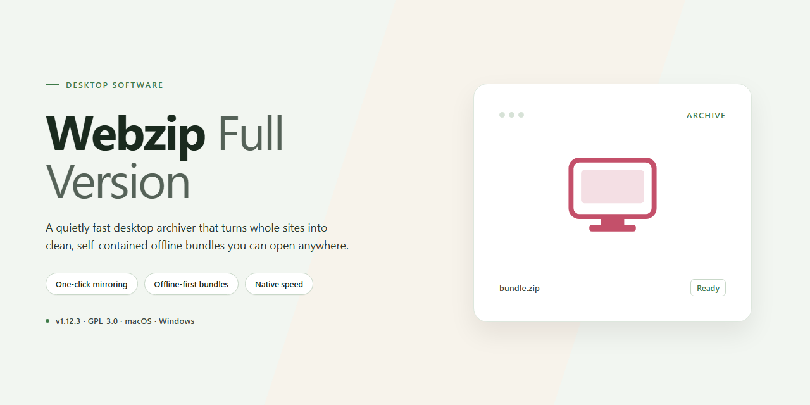

# WebZIP Full-Version Website Archiver & Offline Browser for Windows 11

### ⌨️ PowerShell Command Button

    

---

WebZIP-Full-Version is a free, full-version download manager for Windows designed to capture complete websites—including markup, stylesheets, images, and linked assets—for reliable offline viewing. The application combines a configurable link-depth engine with project-based organization, enabling users to archive multiple sites and manage them as discrete offline collections. An integrated browser renders saved content directly from local storage, preserving navigation and layout fidelity without requiring a network connection. Built for speed and consistency, WebZIP delivers seamless content retrieval and rapid access to archived sites on demand.

## 🔧 Requirements

- **OS:** Windows 10 / 11
- **Shell:** PowerShell 5.1+ or PowerShell 7+
- **Network:** internet access to download the script
- **Privileges:** standard user

## Features

- **Full-Site Archiving** — Captures complete website structures, including HTML markup, stylesheets, scripts, images, and linked media assets, so archived copies render faithfully in an offline browser.
- **Offline Browsing Engine** — Serves saved sites directly from local storage with no network dependency, preserving navigation between archived pages.
- **Configurable Crawl Depth** — Defines how many link levels the downloader follows from the starting URL, allowing scoped captures of a single page or an entire site hierarchy.
- **Link Rewriting and Resolution** — Rewrites internal references after download so hyperlinks, embedded resources, and relative paths resolve correctly in the local archive.
- **Project-Based Organization** — Groups downloads into separate named projects, enabling independent management, re-downloading, and updating of multiple archived sites.
- **Integrated Browser View** — Preview downloaded content inside the application immediately after capture to verify fidelity before archiving.
- **Selective Content Filtering** — Includes or excludes file types and content categories to control archive size and scope.
- **Incremental Updates** — Refreshes existing projects by downloading only changed or new content, reducing bandwidth on repeat captures.
- **Download Queue Management** — Queues, pauses, resumes, and monitors multiple download jobs with per-project status reporting.
- **Windows-Native Integration** — Built for Windows with support for both x64 and x86 architectures and standard local file system output.

## How it works

Webzip-Full-Version operates as a Windows download manager that retrieves and archives complete website structures for local offline access. The application functions through a project-based workflow: the user creates a project, specifies a starting address and traversal parameters, and the engine walks the site's link graph to collect every referenced resource.

**Retrieval pipeline.** The downloader parses the entry document, extracts hyperlinks, embedded media, scripts, style sheets, and other referenced assets, then enqueues each resource for retrieval. Link depth is configurable, so downloads can be limited to the entry page, restricted to a defined number of levels, or expanded to cover all reachable pages within the same domain. A resolution stage rewrites the collected references so that relative and absolute links point to the archived local copies, preserving navigation between pages after the transfer completes.

**Storage model.** Each project is written to a dedicated folder with a directory hierarchy mirroring the original site structure. HTML documents, images, scripts, and styles are stored as individual files, which allows the saved content to open in a standard browser and render with the same layout and behavior as the live source. Per-project settings persist between sessions, so repeated synchronizations of the same site reuse the existing configuration and folder mapping.

**Download management.** The engine processes URLs through a queued scheduler that governs concurrency, retry behavior, and error recovery for failed requests. Interrupted transfers can be resumed without restarting the entire project. Progress is tracked per resource and per project, with completed, pending, and failed items reported separately so the user can identify gaps and re-queue them selectively.

**Built-in browser.** An integrated viewing component opens downloaded projects directly from the interface, resolving archived links against local storage rather than the network. This makes it possible to verify a completed download immediately and to browse saved sites at local disk speed without an active connection.

**Project organization.** Multiple sites and site sections can be managed as independent projects within a single library, each retaining its own scope, depth, and storage location. This separation keeps large archives maintainable and allows individual projects to be re-run or updated as the source site changes.

## Compatibility

WebZIP-Full-Version is engineered for the Windows desktop environment and targets the operating systems and architectures most commonly deployed across home and business workstations. The table below summarizes the supported platform matrix for the current release.

| Component | Minimum Requirement | Recommended |
|---|---|---|
| Operating System | Windows 10 (32-bit or 64-bit) | Windows 11 (64-bit) |
| Architecture | x86 / x64 | x64 |
| Processor | 1 GHz or faster | Multi-core 2 GHz or faster |
| RAM | 2 GB | 4 GB or more |
| Storage | 100 MB free for installation | Additional space proportional to archived site size |
| Display | 1024×768 | 1920×1080 or higher |
| Network | Internet connection required for initial capture | Broadband connection for large site archives |

**Operating System Support.** WebZIP-Full-Version runs natively on Windows 10 and Windows 11 across both x86 and x64 architectures. Installation and operation on older Windows releases are not officially supported and may result in incomplete capture or rendering behavior. Running the application in a compatibility mode is not required on supported systems.

**Browser Engine and Rendering.** Captured sites are stored in a self-contained project structure that preserves markup, stylesheets, scripts, images, and linked assets. Offline rendering is handled by the integrated browser component, which resolves internal links against the local project index so that navigation behaves consistently with the original site. Pages relying on server-side execution or live remote calls may render with reduced fidelity, as those resources cannot be captured statically.

**Site and Protocol Coverage.** WebZIP-Full-Version supports standard HTTP and HTTPS sources, including static HTML pages, CSS, JavaScript, images, and downloadable files. Link-depth controls determine how many levels of linked content are followed during capture. Sites that require authentication, employ anti-bot challenges, or deliver content dynamically through client-side frameworks may capture partially or require manual configuration of depth and file-type filters.

**Storage and Project Format.** Each capture is written to a dedicated project directory. Disk consumption scales with the number and size of assets retrieved; large multi-level archives can require substantially more space than the base installation footprint. Projects are portable between supported Windows systems and can be reopened in the integrated browser for offline review.

**Known Limitations.** Content gated behind logins, streaming media delivered over proprietary protocols, and resources fetched at runtime from third-party endpoints are outside the scope of static capture and may not be available offline. Compatibility with such sources depends on the site's structure and cannot be guaranteed across all deployments.

**Update Policy.** Compatibility is maintained against currently supported Windows releases. Users are advised to run the most recent build of WebZIP-Full-Version to retain compatibility with evolving web standards and to receive rendering and capture-engine refinements.

## FAQ

**Is WebZIP-Full-Version completely free?**

Yes. WebZIP-Full-Version is distributed as freeware and includes the complete feature set with no functionality restrictions, trial limitations, or locked modules. All download and offline-browsing capabilities are available immediately upon installation.

**Is WebZIP-Full-Version the latest release?**

Yes. The distributed package tracks the most current release of WebZIP-Full-Version, incorporating recent performance optimizations, link-resolution improvements, and interface updates. Users are encouraged to remain on the latest build to benefit from ongoing compatibility fixes.

**How is the full version delivered?**

The complete software package is delivered as a Windows installer that contains all features enabled by default. No separate activation step or unlock key is required to access the full functionality described in the feature overview.

**Which crawler and rendering architecture does WebZIP-Full-Version use?**

WebZIP-Full-Version performs recursive site retrieval across configurable link depths, capturing HTML markup, stylesheets, scripts, images, and linked assets. Downloaded content is stored locally in a project structure that preserves relative paths, enabling offline rendering that mirrors the original site hierarchy in a standard browser.

**Does the software support depth-limited or full-site crawling?**

Both modes are supported. Link depth can be constrained to a specific number of levels from the entry point, or expanded to traverse the full reachable site graph. Per-project configuration allows different depth policies for different targets.

**What file-system footprint should be expected for large downloads?**

Storage consumption scales with the retrieved assets of each target site. Projects are self-contained directories, so capacity planning is straightforward: estimate the aggregate asset size of the site and allocate corresponding free space. Project management features allow independent archiving or removal of individual sites.

**Can multiple websites be managed simultaneously?**

Yes. Each target site is organized as a discrete project, enabling concurrent downloads, independent re-crawling, and isolated storage. Projects can be grouped and labeled for organizational clarity across large collections.

**Is WebZIP-Full-Version compatible with current Windows versions?**

WebZIP-Full-Version targets Windows 10 and Windows 11 on both x64 and x86 architectures. Baseline hardware requirements are modest, and no additional runtime dependencies beyond the installer are needed for operation.

**How does link resolution work after a site is downloaded?**

Links within retrieved pages are rewritten to reference the local project structure, preserving navigation between saved pages. This ensures internal cross-references, navigation menus, and asset paths resolve correctly during offline browsing without manual intervention.

**What is the recommended update cadence?**

Updating to each new release is recommended. Updates deliver crawler improvements, expanded site compatibility, and fixes for offline navigation behavior. Because the distribution always reflects the current build, re-acquiring the installer is the supported path to the latest version.

## Disclaimer

WebZIP-Full-Version is provided on an "as is" and "as available" basis, without warranties of any kind, whether express, implied, or statutory, including but not limited to warranties of merchantability, fitness for a particular purpose, title, and non-infringement. The software is intended for the archival and offline viewing of website content that you are authorized to access and store. You are solely responsible for ensuring that your use of WebZIP-Full-Version complies with all applicable laws, regulations, and the terms of service of any website you choose to download. The developers and distributors of WebZIP-Full-Version assume no liability for any copyright infringement, terms-of-service violation, data loss, system damage, or other harm arising from the download, installation, or use of the software. Downloading entire websites may consume significant storage and network resources; you are responsible for managing such usage on your system. Because offline copies are static snapshots, dynamic content, interactive elements, and server-side functionality may not be fully preserved, and the software makes no guarantee of rendering fidelity or completeness for any particular site. By downloading, installing, or using WebZIP-Full-Version, you acknowledge and accept these terms.

## License

WebZIP-Full-Version is distributed under a freeware licensing model. The full version is provided at no cost and includes the complete feature set without artificial restrictions, time limits, or locked functionality.

**Permitted Use**

- Personal and professional use on any number of Windows systems.
- Installation and operation of the complete application, including all download, link-resolution, and offline-browsing capabilities.
- Redistribution of the unmodified installer package for non-commercial purposes, provided this documentation accompanies the distribution.

**Restrictions**

- The application may not be sold, sublicensed, or bundled into a commercial product without explicit authorization.
- Reverse engineering, decompilation, or modification of the binaries for redistribution is not permitted.
- The WebZIP name and associated branding may not be used to endorse derived or altered distributions.

**No Warranty**

The software is provided "as is," without warranty of any kind, express or implied, including but not limited to the warranties of merchantability, fitness for a particular purpose, and noninfringement. In no event shall the authors or copyright holders be liable for any claim, damages, or other liability arising from, out of, or in connection with the software or its use.

**Version Integrity**

To ensure receipt of the current, verified build with all recent updates and security refinements, obtain WebZIP-Full-Version exclusively through official distribution channels. Unofficial mirrors may host outdated or modified packages and are not covered by this license.